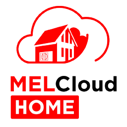

# ioBroker.melcloudhome

[](https://www.npmjs.com/package/iobroker.melcloudhome)
[](https://www.npmjs.com/package/iobroker.melcloudhome)


[](https://nodei.co/npm/iobroker.melcloudhome/)

**Tests:** 

## melcloudhome adapter for ioBroker

This adapter connects [ioBroker](https://www.iobroker.net/) to the **MELCloud Home** cloud platform and lets you
read and control Mitsubishi Electric Air-to-Air (climate/AC) and Air-to-Water (heat pump) units.

### Disclaimer

This is an independent, community-created adapter. It is **not developed, endorsed, or supported by Mitsubishi
Electric Corporation**. "Mitsubishi Electric" and "MELCloud Home" are trademarks of their respective owner and are
used here only to describe compatibility. Use of this adapter and the MELCloud Home cloud service is subject to
Mitsubishi Electric's own terms of service; use it at your own risk.

### Credits

The MELCloud Home API integration (login flow, REST endpoints, realtime WebSocket protocol) was implemented based
on the reverse-engineering work of the Python library
[aiomelcloudhome](https://github.com/erwindouna/aiomelcloudhome) by [erwindouna](https://github.com/erwindouna).
This adapter is an independent TypeScript implementation and is not affiliated with that project.

## Features

- Login with your MELCloud Home account (username/password), including the full OAuth2/PKCE + Cognito login flow
  used by the official app.
- Cyclic polling of all buildings/units on a configurable interval.
- Optional realtime updates via the MELCloud Home WebSocket, applied between polls.
- Automatically creates ioBroker objects for every Air-to-Air (`ata`) and Air-to-Water (`atw`) unit found in your
  account, including capabilities and frost/overheat/holiday-mode information.
- Control unit state directly from ioBroker (power, operation mode, target temperature, fan speed, vane
  positions, standby mode, and more) by writing to the corresponding states.
- The OAuth session is persisted internally, so the adapter does not need to log in again on every restart.

## Configuration

Open the instance settings and fill in:

| Setting                                          | Description                                                                                                                      |
| ------------------------------------------------ | -------------------------------------------------------------------------------------------------------------------------------- |
| **MELCloud Home username (email)**               | The email address you use to log in to the MELCloud Home app.                                                                    |
| **MELCloud Home password**                       | Your MELCloud Home account password. Stored encrypted in the adapter configuration.                                              |
| **Poll interval (seconds)**                      | How often to fetch the full state from the MELCloud Home API (minimum 15 seconds).                                               |
| **Use realtime WebSocket updates between polls** | If enabled, unit state changes are pushed to ioBroker as soon as MELCloud Home reports them, in addition to the regular polling. |

## Object tree

For every building in your account, the adapter creates:

```
<buildingId>.ata.<unitId>.<state>              Air-to-Air unit states (power, operationMode, setTemperature, ...)
<buildingId>.ata.<unitId>.capabilities.*        Read-only unit capabilities
<buildingId>.ata.<unitId>.frostProtection.*     Read-only frost protection status
<buildingId>.ata.<unitId>.overheatProtection.*  Read-only overheat protection status
<buildingId>.ata.<unitId>.holidayMode.*         Read-only holiday mode status
<buildingId>.atw.<unitId>.<state>              Air-to-Water unit states (power, zone temperatures, ...)
```

States marked as writable in the object tree can be changed to control the corresponding unit; all other states are
updated automatically from MELCloud Home.

## Known limitations

- Frost protection, overheat protection and holiday mode are currently read-only (informational).
- Energy/telemetry history and the outdoor-temperature trend endpoints are not (yet) exposed.

## Changelog

<!--
	Placeholder for the next version (at the beginning of the line):
	### **WORK IN PROGRESS**
-->
### 0.2.2 (2026-08-26)

- (konrad2002) fix release notes not correctly translated ._.

### 0.2.1 (2026-08-26)

- (konrad2002) fix release pipeline

### 0.2.0 (2026-08-26)

- (konrad2002) no unreleased changes yet

### 0.1.0 (2026-08-25)

- (konrad2002) first working version: MELCloud Home login, polling, realtime WebSocket updates and control for Air-to-Air and Air-to-Water units

### 0.0.2 (2026-08-25)

- (konrad2002) fix connection issues

### 0.0.1 (2026-08-25)

- (konrad2002) initial release

## License

MIT License

Copyright (c) 2026 konrad2002 <konrad@swimresults.de>

Permission is hereby granted, free of charge, to any person obtaining a copy
of this software and associated documentation files (the "Software"), to deal
in the Software without restriction, including without limitation the rights
to use, copy, modify, merge, publish, distribute, sublicense, and/or sell
copies of the Software, and to permit persons to whom the Software is
furnished to do so, subject to the following conditions:

The above copyright notice and this permission notice shall be included in all
copies or substantial portions of the Software.

THE SOFTWARE IS PROVIDED "AS IS", WITHOUT WARRANTY OF ANY KIND, EXPRESS OR
IMPLIED, INCLUDING BUT NOT LIMITED TO THE WARRANTIES OF MERCHANTABILITY,
FITNESS FOR A PARTICULAR PURPOSE AND NONINFRINGEMENT. IN NO EVENT SHALL THE
AUTHORS OR COPYRIGHT HOLDERS BE LIABLE FOR ANY CLAIM, DAMAGES OR OTHER
LIABILITY, WHETHER IN AN ACTION OF CONTRACT, TORT OR OTHERWISE, ARISING FROM,
OUT OF OR IN CONNECTION WITH THE SOFTWARE OR THE USE OR OTHER DEALINGS IN THE
SOFTWARE.
